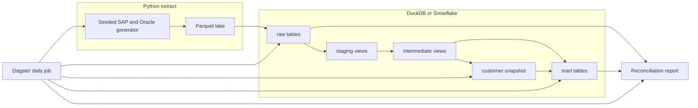
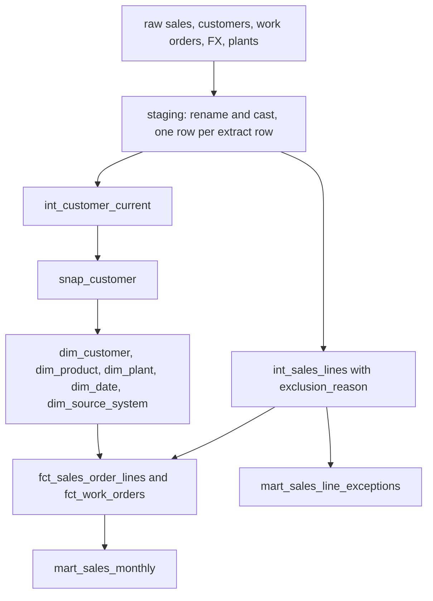
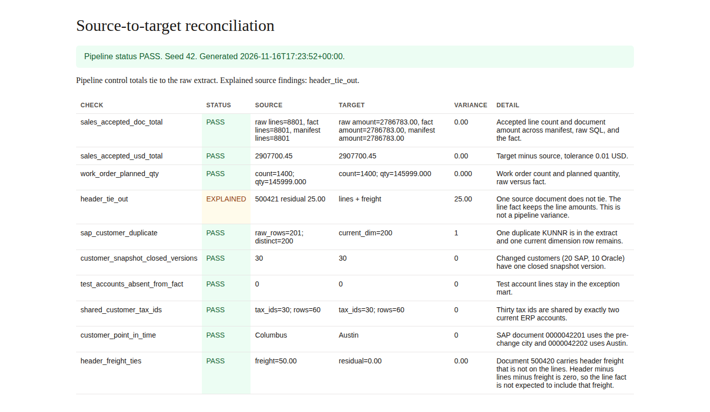

# snowflake-dbt-data-platform

Multi-ERP ELT for SAP ECC and Oracle EBS sales and work orders. Python lands a deterministic extract, dbt builds a star schema with a type 2 customer dimension, and an independent reconciliation checks raw totals against the marts. DuckDB is the default warehouse so the project runs locally for free. A Snowflake profile is included for the same models.

The dataset is synthetic. It is shaped like those ERPs, including planted defects a reconciliation is supposed to explain. It is not a dump from a real system, and the FX rates are not market data.

## Architecture



The customer snapshot runs twice in one job. The first pass sees the 2025-06-30 customer extract. The second pass sees the 2025-12-15 extract, closes the changed versions, and only then builds facts. Facts point-in-time join the customer dimension on the order date, using `dbt_valid_from`, which is the business `updated_at` rather than the clock time of the run.



## Quickstart

Requires Python 3.12 and [uv](https://docs.astral.sh/uv/).

```bash
uv sync --all-groups
make pipeline
```

`make pipeline` generates the lake, loads DuckDB, snapshots customers, runs `dbt build`, and writes `data/reports/reconciliation.md`. The pipeline exits non-zero if any check is `FAIL`. A known source defect is reported as `EXPLAINED` and does not fail the run.

Other entry points:

```bash
make test          # pytest, including the pipeline
make lint          # ruff
make sqlfluff      # dbt SQL
make dagster       # UI on http://127.0.0.1:3000
make extract       # parquet lake only
```

Dagster materializes the same steps as assets:

```bash
uv run dagster asset materialize -m meridian.orchestration.definitions --select '*'
```

The daily schedule is `0 6 * * *` UTC and is stopped by default, so opening the UI does not start a second run.

## What a seed-42 run produces

These figures are from `make pipeline` / the Dagster materialization on 2026-11-16, seed 42. The copy of that report is [`docs/examples/reconciliation.md`](docs/examples/reconciliation.md).

| Check | Result |
| --- | --- |
| Accepted sales lines, manifest = raw SQL = fact | 8,801 lines, document amount 2,786,783.00 |
| Accepted sales USD, raw SQL = fact | 2,907,700.45 |
| Work orders, raw = fact | 1,400 orders, planned quantity 145,999.000 |
| Header tie-out | EXPLAINED. Oracle order `500421` is 25.00 over lines + freight |
| SAP customer duplicate | 201 extract rows, 200 current dimension rows |
| Closed customer versions | 30 |
| Test-account lines in the fact | 0 |
| Shared tax ids | 30 tax ids, 60 current accounts |
| Point-in-time customer | SAP `0000042201` is Columbus, `0000042202` is Austin |

Accepted lines by source, from `meridian_marts.fct_sales_order_lines`:

| Source | Documents | Lines | Document amount | USD amount | Return lines |
| --- | ---: | ---: | ---: | ---: | ---: |
| SAP ECC | 2,457 | 4,929 | 1,578,675.25 | 1,645,604.37 | 189 |
| Oracle EBS | 1,965 | 3,872 | 1,208,107.75 | 1,262,096.08 | 165 |

Excluded lines stay in `mart_sales_line_exceptions`:

| Reason | Lines | Document amount |
| --- | ---: | ---: |
| CANCELLED | 141 | 50,242.00 |
| REJECTED_LINE | 40 | 12,500.00 |
| TEST_ACCOUNT | 12 | 303.00 |
| INVALID_CURRENCY | 1 | 45.00 |

Work orders in `fct_work_orders`: 873 closed, 330 in process, 197 created. Of the closed jobs, 308 have `on_time = true` (`actual_finish_date` on or before `scheduled_finish_date`).

`dbt build` on that run: 33 models, 1 snapshot, 102 data tests, 1 seed, 14 sources. The full build reported 137 passes, 0 warnings, 0 errors.



## Star schema

| Model | Grain |
| --- | --- |
| `fct_sales_order_lines` | One accepted sales line. Customer key is the version effective on the order date. |
| `fct_work_orders` | One production order or discrete job, every status. |
| `dim_customer` | One SCD2 version per source customer. |
| `dim_product` | One item per ERP. Not slowly changing. Cross-ERP match is the GTIN. |
| `dim_plant` | One plant or inventory organization. |
| `dim_date` | One day, 2024-01-01 through 2026-12-31. Fiscal year starts 1 July. |
| `dim_source_system` | SAP ECC or Oracle EBS. |
| `mart_sales_line_exceptions` | One excluded line and its reason. |
| `mart_sales_monthly` | Month, source, plant, and document currency. Do not sum `net_amount_doc` across currencies. |
| `bridge_shared_customer` | Current accounts that share a tax id. |
| `bridge_shared_product` | Items that share a GTIN. |

Each order in this dataset is single-plant, single-customer, and single-currency. `mart_sales_monthly.order_count` is a distinct document count inside that grain. Staging does not drop the duplicate SAP customer; `int_customer_current` does.

Schemas on DuckDB are `raw`, `meridian_staging`, `meridian_intermediate`, `meridian_marts`, `meridian_reference`, and `snapshots`. The `meridian_` prefix is dbt's default custom-schema behavior, which is what you want when the Snowflake target schema changes per environment.

## Reconciliation

`src/meridian/quality/reconcile.py` reads raw tables and marts with its own SQL. It does not call dbt. Document-amount control totals are compared three ways: the extract manifest, that SQL, and the fact. USD is recomputed with the same `round(amount * rate, 2)` expression as `int_sales_lines` and compared to the fact.

Header freight on Oracle order `500420` is 50.00 and is not on the lines. Header minus lines minus freight is zero, so the line fact is not expected to contain it. Order `500421` is a real source imbalance of 25.00. The report classifies it as `EXPLAINED`. Any other residual fails the run. The same rule is a dbt singular test against `seeds/known_header_gaps.csv`.

Exclusion priority, first match wins: `TEST_ACCOUNT`, `CANCELLED`, `REJECTED_LINE`, `INVALID_CURRENCY`, `MISSING_QUANTITY`, `MISSING_FX`. The Python function, the dbt macro, and the reconciler SQL use that order. The integration test fails if they drift.

## Snowflake

Local CI does not connect to Snowflake. The alternate target is in [`transform/profiles.yml.example`](transform/profiles.yml.example) and uses key-pair auth from environment variables.

```bash
uv sync --extra snowflake
export SNOWFLAKE_ACCOUNT=...
export SNOWFLAKE_USER=...
export SNOWFLAKE_PRIVATE_KEY_PATH=...
# create RAW with the same table names, then load the lake
uv run dbt build --project-dir transform --profiles-dir transform --target snowflake
```

`src/meridian/ingest/snowflake_load.py` builds `COPY INTO raw.<table>` statements with `MATCH_BY_COLUMN_NAME`. Those statements are unit tested. They are not executed in CI.

Identifiers are unquoted, so Snowflake uppercases them and DuckDB matches them case-insensitively. Models avoid warehouse-specific SQL: dates use `extract`, work-order cycle time uses `datediff`, and surrogate keys come from `dbt_utils`.

## Layout

```text
src/meridian/ingest          generator, parquet lake, DuckDB load, Snowflake COPY SQL
src/meridian/quality         source-to-target reconciliation and the report
src/meridian/orchestration   Dagster definitions, job, and schedule
src/meridian/pipeline.py     the local end-to-end command
transform                    dbt project, profiles, packages
tests                        generator, load, pipeline, Dagster graph, COPY SQL
docs/WALKTHROUGH.md          how to talk through this in an interview
docs/DECISIONS.md            why these pieces, not the neighbors
```

## Tests and CI

GitHub Actions runs ruff, pytest (the pipeline test included), and sqlfluff against the dbt project on DuckDB. `dbt_expectations` checks bounds and allowed values next to the models. Singular tests check header residuals, fact control totals, snapshot history, overlapping customer versions, test-account leakage, and the shared-key bridges.

## Design notes

See [docs/DECISIONS.md](docs/DECISIONS.md). The interview walkthrough is [docs/WALKTHROUGH.md](docs/WALKTHROUGH.md).

A container build is in `Dockerfile` and `.devcontainer/`. It is optional. The supported path is `uv` on the host.
